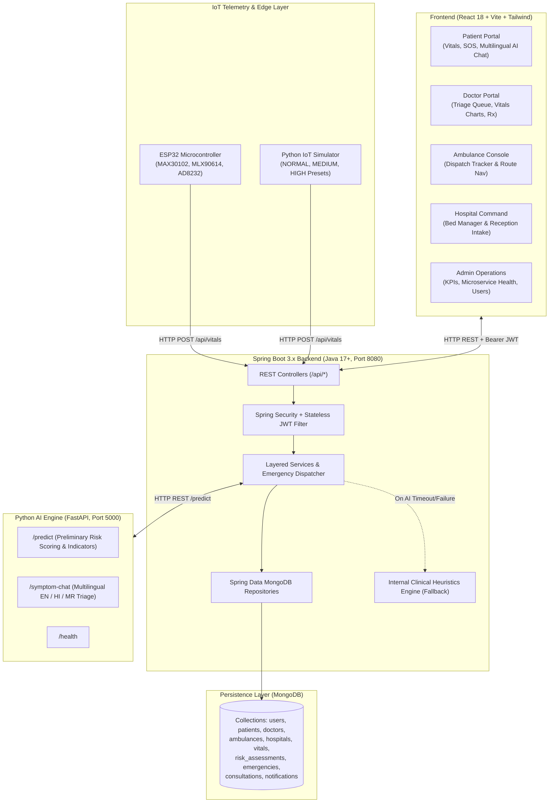
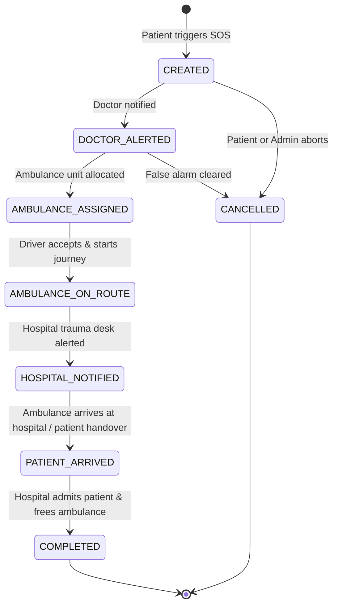

# JeevanSetu AI – Architecture & System Design

## 1. Executive Overview

**JeevanSetu AI (जीवनसेतू)** is a mission-critical rural healthcare and emergency coordination platform designed for remote and underserved geographies. The platform bridges the gap between rural citizens, village health workers (ASHA/ANM), primary health clinics, emergency ambulance fleets, tele-consulting doctors, and sub-district/district trauma hospitals.

---

## 2. System Architecture Diagram

---

## 3. Core Architectural Modules

### 3.1. Frontend Single Page Application (React 18 + Vite)
- **Centralized API Client (`apiClient.js`)**: Configured with `import.meta.env.VITE_API_URL` (defaulting to `http://localhost:8080/api`), handles JWT injection via request interceptor, and standardizes error responses.
- **Context API (`AuthContext.jsx`)**: Manages authentication tokens, current user metadata, role-based redirection, and persistent sessions via `localStorage`.
- **Protected Routing (`ProtectedRoute.jsx`)**: Enforces fine-grained role authorization across 5 distinct personas:
  - `PATIENT`
  - `DOCTOR`
  - `AMBULANCE_DRIVER`
  - `HOSPITAL`
  - `ADMIN`
- **Telemetry Visualizations (`Recharts`)**: Responsive time-series charts rendering heart rate, oxygen saturation (SpO2), blood pressure systolic/diastolic, and infrared body temperature.
- **Multilingual Support**: Conversational triage assistant capable of interacting in English, Hindi (हिंदी), and Marathi (मराठी).

### 3.2. Spring Boot 3.x Backend
- **Layered Architecture**: Strict separation of concerns across `Controller -> Service -> Repository -> Database`.
- **Stateless JWT Security**: Passwords salted and hashed with `BCryptPasswordEncoder`, authenticated requests validated using `JwtAuthenticationFilter`.
- **Cross-Role Emergency Dispatch Lifecycle**: When an SOS is triggered, `EmergencyService` atomically:
  1. Identifies the closest available ambulance fleet unit and sets its status to `ASSIGNED`.
  2. Identifies the nearest hospital with available beds and ready intake.
  3. Alerts designated tele-consultation doctors.
  4. Dispatches in-app push notifications to all 4 involved roles simultaneously.
- **Resilient AI Client (`AiClientService`)**: Communicates with the Python AI microservice using Spring's `RestTemplate` with strict timeouts. If the AI service is unreachable, it seamlessly evaluates vitals using internal emergency clinical triage rules without failing the user request.

### 3.3. Python AI Microservice (FastAPI)
- **Triage Assessment (`/predict`)**:
  - Ingests: `{ patientId, age, heartRate, spo2, temperature, systolic, diastolic, symptoms }`
  - Returns: `riskLevel` (`LOW`, `MEDIUM`, `HIGH`), `riskScore` (0-100), clinical `indicators`, and triage recommendations.
  - Disclaimer banner: *"Preliminary guidance only; not a formal medical diagnosis."*
- **Multilingual Symptom Assistant (`/symptom-chat`)**:
  - Semantic parsing of colloquial complaints in English, Hindi, and Marathi (e.g., "माझ्या छातीत खूप दुखत आहे", "सांस लेने में तकलीफ हो रही है", "severe crushing chest pressure").

### 3.4. IoT Biometric Telemetry & Simulation
- **ESP32 Firmware (`jeevansetu_esp32.ino`)**:
  - Drivers for MAX30102 (pulse oximetry & optical heart rate), MLX90614 (non-contact infrared temperature), AD8232 (single-lead ECG analog stream).
  - Unauthenticated ingestion endpoint (`POST /api/vitals`) allows resource-constrained microcontrollers to push telemetry without heavy crypto overhead.
- **Python Simulator (`iot_simulator.py`)**:
  - Supports `--preset NORMAL`, `--preset MEDIUM`, `--preset HIGH`, continuous streaming, and custom patient targeting.

---

## 4. Emergency SOS State Machine Lifecycle

---

## 5. Security & Data Protection
- **Role-Based Access Control (RBAC)**: All administrative, doctor, and fleet endpoints protected by Spring Security filters.
- **HIPAA/Disclaimers Alignment**: All AI-assisted triage outputs are explicitly framed as preliminary assistive guides and never represented as certified medical diagnoses.
- **CORS Configuration**: Configured to permit requests from the Vite frontend origin (`http://localhost:5173`) with credentials.
