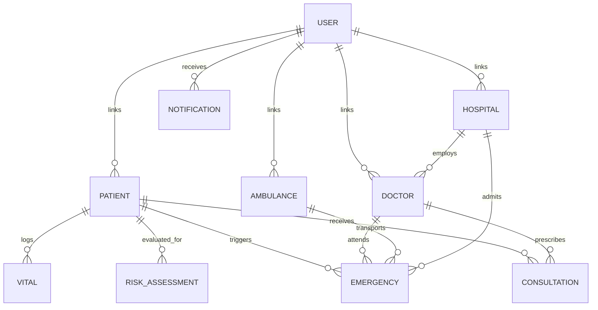

# JeevanSetu AI – MongoDB Database Schema

## 1. Overview
JeevanSetu AI utilizes MongoDB as its document database. Each collection supports horizontal scalability and JSON document models tailored to healthcare telemetry and rapid emergency dispatch workflows.

---

## 2. Collections & Document Definitions

### 2.1. `users` Collection
Stores authentication credentials and global role memberships.

```json
{
  "_id": "670c...",
  "email": "patient1@jeevansetu.org",
  "password": "$2a$10$hashed_bcrypt_password...",
  "name": "Ramesh Patil",
  "phone": "9876543210",
  "role": "PATIENT",
  "entityId": "P1001",
  "active": true,
  "createdAt": "2026-10-14T09:00:00"
}
```

*Indexes:*
- `email`: UNIQUE

---

### 2.2. `patients` Collection
Demographic and primary health profiling for rural residents.

```json
{
  "_id": "P1001",
  "name": "Ramesh Patil",
  "age": 62,
  "gender": "Male",
  "phone": "9876543210",
  "email": "patient1@jeevansetu.org",
  "village": "Koregaon Bhima",
  "district": "Pune",
  "address": "House No. 42, Near Gram Panchayat Office",
  "emergencyContact": "9876543219",
  "medicalHistory": ["Hypertension", "Type 2 Diabetes", "Mild Asthma"],
  "userId": "670c...",
  "createdAt": "2026-10-14T09:00:00"
}
```

---

### 2.3. `doctors` Collection
Physician credentials and hospital affiliations.

```json
{
  "_id": "doc1",
  "name": "Dr. Aarav Sharma",
  "specialization": "Cardiologist & Emergency Medicine",
  "phone": "9822011223",
  "email": "doctor1@jeevansetu.org",
  "hospitalId": "hosp1",
  "available": true,
  "userId": "670d...",
  "createdAt": "2026-10-14T09:00:00"
}
```

---

### 2.4. `vitals` Collection
Streamed biometric readings from ESP32 sensors (MAX30102, MLX90614, AD8232) and manual station entries.

```json
{
  "_id": "670e...",
  "patientId": "P1001",
  "heartRate": 118,
  "spo2": 89,
  "temperature": 101.4,
  "systolic": 158,
  "diastolic": 98,
  "ecg": "SINUS_TACHYCARDIA_LEAD_II",
  "timestamp": "2026-10-14T09:30:00",
  "source": "ESP32_MAX30102"
}
```

*Indexes:*
- `patientId`: ASCENDING
- `timestamp`: DESCENDING

---

### 2.5. `risk_assessments` Collection
Persisted outputs from preliminary AI triage assessments.

```json
{
  "_id": "670f...",
  "patientId": "P1001",
  "riskLevel": "HIGH",
  "riskScore": 88,
  "indicators": [
    "Hypoxia alert: SpO2 89% < 92%",
    "Tachycardia alert: Heart Rate 118 BPM > 100 BPM",
    "Hypertensive Stage 2: Systolic BP 158 mmHg"
  ],
  "recommendation": "URGENT: Alert doctor and dispatch emergency ambulance immediately.",
  "disclaimer": "AI-assisted preliminary risk assessment. Never claim it is a medical diagnosis.",
  "evaluatedAt": "2026-10-14T09:30:05"
}
```

---

### 2.6. `emergencies` Collection
Core state machine tracking active rural SOS incidents.

```json
{
  "_id": "em-882190",
  "patientId": "P1001",
  "riskLevel": "HIGH",
  "symptoms": [
    "Crushing chest pressure",
    "Severe shortness of breath",
    "Profuse cold sweating"
  ],
  "latitude": 18.5204,
  "longitude": 73.8567,
  "doctorId": "doc1",
  "ambulanceId": "amb1",
  "hospitalId": "hosp1",
  "status": "AMBULANCE_ON_ROUTE",
  "notes": "Emergency SOS triggered by patient from portal",
  "createdAt": "2026-10-14T09:35:00",
  "updatedAt": "2026-10-14T09:37:00"
}
```

*Valid `status` Enum Values:*
`CREATED`, `DOCTOR_ALERTED`, `AMBULANCE_ASSIGNED`, `AMBULANCE_ON_ROUTE`, `HOSPITAL_NOTIFIED`, `PATIENT_ARRIVED`, `COMPLETED`, `CANCELLED`

---

### 2.7. `ambulances` Collection
Emergency fleet vehicle tracking and GPS dispatch status.

```json
{
  "_id": "amb1",
  "driverName": "Suresh Yadav",
  "phone": "9823055441",
  "vehicleNumber": "MH-12-RN-4401",
  "latitude": 18.8200,
  "longitude": 74.3700,
  "status": "ON_ROUTE",
  "currentEmergencyId": "em-882190",
  "userId": "670g...",
  "updatedAt": "2026-10-14T09:37:00"
}
```

*Valid `status` Enum Values:*
`AVAILABLE`, `ASSIGNED`, `ON_ROUTE`, `ARRIVED`, `COMPLETED`

---

### 2.8. `hospitals` Collection
Sub-district and district trauma hospital registry.

```json
{
  "_id": "hosp1",
  "name": "Rural Sub-District Hospital Shirur",
  "address": "Main Road, Shirur, Pune District, Maharashtra 412210",
  "district": "Pune",
  "phone": "02138-222100",
  "latitude": 18.8288,
  "longitude": 74.3797,
  "emergencyAvailable": true,
  "availableBeds": 14,
  "totalBeds": 50,
  "userId": "670h..."
}
```

---

### 2.9. `consultations` Collection
Clinical tele-consultation records and digital prescriptions.

```json
{
  "_id": "cons-101",
  "patientId": "P1001",
  "doctorId": "doc1",
  "diagnosis": "Acute Angina / Rule out NSTEMI",
  "notes": "Administer oxygen immediately, maintain rest, expedite hospital arrival.",
  "prescriptions": [
    "Tab Sorbitrate 5mg sublingual stat",
    "Tab Aspirin 325mg stat",
    "Tab Clopidogrel 300mg stat"
  ],
  "createdAt": "2026-10-14T09:40:00"
}
```

---

### 2.10. `notifications` Collection
In-app push alerts for real-time workflow coordination across roles.

```json
{
  "_id": "670k...",
  "userId": "670d...",
  "type": "DOCTOR_ALERT",
  "title": "URGENT: Rural Emergency SOS Alert",
  "message": "Emergency case assigned for patient Ramesh Patil in village Koregaon Bhima",
  "referenceId": "em-882190",
  "read": false,
  "createdAt": "2026-10-14T09:35:05"
}
```

---

## 3. Entity Relationship Diagram


